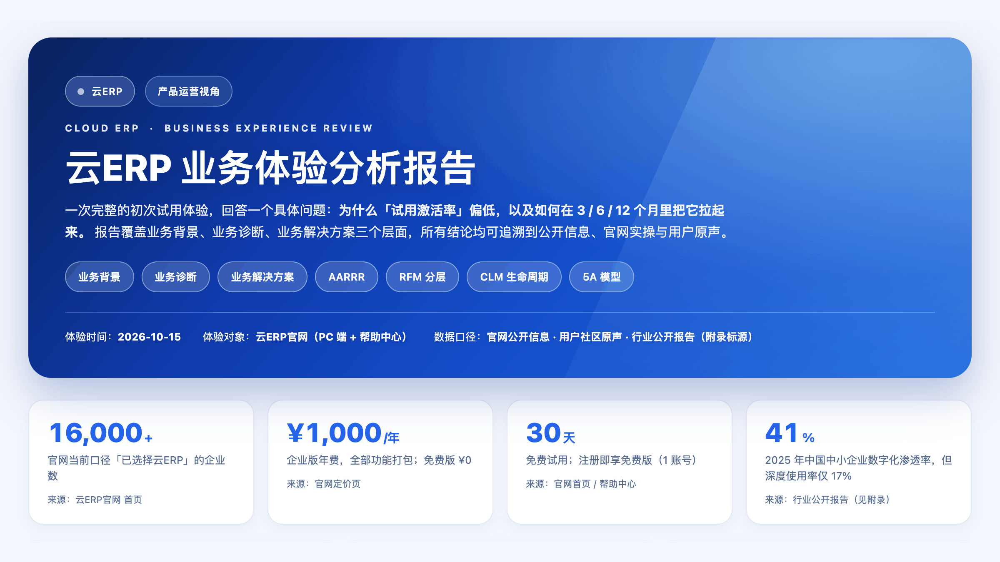
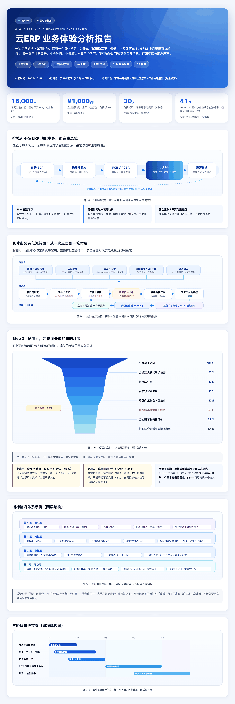

# 业务体验分析报告工具包

> 把一次产品/业务的初次试用体验，变成一份结论有据可查、可分享、可后续手动编辑的 HTML 分析报告（另出 PDF）。仓库含两个配套技能，装进 skills 目录即可用、无需写代码：① 业务体验报告生成器——从岗位 JD、体验链接与截图出发，按「业务背景／业务诊断／业务解决方案」三章推进，内置激活漏斗根因分析与多维下钻、3-6-12 月解法规划、AARRR／RFM／CLM／5A 方法论映射、指标体系与 RACI 资源预算；② 报告视觉评审官——对成品报告做对抗性视觉审查，输出 P0/P1/P2 分级且可执行的修改项。另含两道强制闸门（登录受阻先索取截图、交付后附核对清单）与对比度溢出自动审计脚本。适合产品／运营岗求职作品集、内部汇报与产品试用诊断。成品为单文件 HTML，可直接分享或改文字。



<details>
<summary><b>展开完整报告长图</b>（含 5 张自绘图表：生态闭环 / 业务转化流转 / 试用激活漏斗 / 指标监测体系 / 三阶段里程碑）</summary>

<br>



</details>

*以上为示例报告截图，产品名与域名已做脱敏处理。*

---

## 这是什么

给一个 AI Agent 一套**可复用的分析方法与交付规范**，让它把「我体验了一个产品」推进到「我诊断了一个业务问题」。

两个技能各管一段，串起来是一条完整流水线：

```
输入                          business-experience-report            report-visual-reviewer
JD（岗位职责）      ─┐
体验链接 / 截图      ├──▶   9 步工作流 → 三章 HTML 报告  ────▶   对抗性视觉审查 → P0/P1/P2 修改项
体验目的（体检问题）  ─┘        （另出 PDF）                        （改完复跑审计直到归零）
```

| 技能 | 负责什么 | 产出 |
|---|---|---|
| **business-experience-report** | 从输入到报告的**全流程**：输入采集与口径对齐 → 取证 → 业务诊断（激活漏斗 + 根因分级）→ 业务解决方案（3/6/12 月）→ JD 能力对标 → 生成 HTML → 视觉评审 → 交付 | 单文件 HTML 报告 + A4 PDF + 可编辑源文件 |
| **report-visual-reviewer** | 只做一件事：**视觉与信息层级的对抗性审查**，不改内容、不改数据、不改结论 | P0/P1/P2 分级问题清单，每条定位到具体元素并给出具体修改值 |

第二个技能可以独立使用——你手上任何一份 B 端报告 HTML，丢给它都能审。

## 它和「让 AI 随手写一份产品分析」的区别

| 维度 | 随手写 | 本工具包 |
|---|---|---|
| **证据** | 凭印象描述功能 | 证据分四类（实测 / 官方文档 / 用户原声 / 推演），逐条标注来源与 URL；**判断来自文档而非实操时**，强制打「待实测校准」标记 |
| **准确性闸门** | 登录不进去就靠猜，照常出报告 | **闸门一**：登录受阻时**停下来**输出截图索取清单等回传。宁可等，不猜 |
| **返工防护** | 报告交付即结束 | **闸门二**：交付后附核对清单，请你对照截图复核结论，按反馈修订 |
| **结论形态** | 罗列功能与问题 | 必须回答「**谁在哪个环节、因何流失**」并给出优先级；单条根因不足即视为未完成 |
| **方法论** | 提到就算用过 | 每个阶段必需映射到具体框架（AARRR 的 Activation、RFM 分层、CLM 全链路、5A 种草），并给出验证方法 |
| **视觉** | 好看就行 | WCAG 2.1 AA 对比度自动审计（正文 4.5:1 / 大字 3:1）、横向溢出、断图、SVG 文字越界逐项归零 |
| **交付自检** | 没有 | `check_report.py` 自动校验章节完整性、来源标注、推演数据标记、PDF 空白页 |

## 安装

技能目录名**必须**与 `SKILL.md` 里的 `name` 字段一致，否则可能加载失败。

```bash
# 方式一：克隆后复制
git clone https://github.com/Yibaochan0314/business_experience_report_kit_skill.git
cp -R business_experience_report_kit_skill/business-experience-report ~/.workbuddy/skills/
cp -R business_experience_report_kit_skill/report-visual-reviewer     ~/.workbuddy/skills/

# 方式二：在 GitHub 页面点 Code → Download ZIP，解压后把两个子目录复制进 ~/.workbuddy/skills/
```

装完后确认技能列表里能看到这两个技能。**如果之前装过旧版，请先删除旧目录再放入新目录**——skill 不会自动更新。

> 技能格式为 `SKILL.md` + `references/` + `scripts/` + `assets/` 的通用目录约定。

## 使用

不用敲命令，用自然语言触发即可。

**生成报告**：

```
帮我做一份业务体验分析报告。
JD：（粘贴岗位职责）
体验对象：https://... （或产品名 + 你提供的截图）
体验目的：诊断该产品试用激活率偏低的原因
报告定位：求职作品集
```

如果登录被安全校验拦住，它会**停下来**给你一份截图索取清单（要截哪些页、每张看什么、用于验证哪条判断），你回传截图后它才继续。

**评审报告**：

```
用报告视觉评审官审一下这份 HTML：/path/to/report.html
```

## 报告长什么样

固定三章，每章有必填项：

| 章节 | 内容 |
|---|---|
| **一、业务背景** | 公司背景与产品定位；行业背景与目标用户画像 |
| **二、业务诊断** | 业务流程与核心路径体验（核心功能 + 业务转化流转图 + 运营手段 + 获客渠道 + 定价策略 + 亮点/不足）；试用激活率低的根因分析（定义激活标准 → 搭漏斗定位流失环节 → 多维度下钻 → 根因与优先级） |
| **三、业务解决方案** | 问题定义标准与可衡量指标；3/6/12 月三阶段方案（里程碑 + 效果预估 + 配合部门 + 资源投入）；方法论映射 + 验证方法 + 指标监测体系 |
| **附录 A** | 信息来源与数据口径声明（分公开信息 / 用户原声 / 行业报告 / 实测四类，逐条带 URL） |
| **附录 B** | 岗位能力对标自查（求职场景；JD 每条职责 → 报告第几章答了什么） |

视觉上提供一套开箱即用的设计系统（`assets/report-skeleton.html`，含 260+ 行已验证对比度的 CSS）：蓝色渐变主视觉、指标卡、证据组、阶段卡、指标树。**换视觉基线也很简单**——`references/06-visual-system.md` 里写了「参考图解析法」，把你喜欢的报告截图丢进去，解析成设计令牌替换即可。

## 仓库结构

```
business_experience_report_kit_skill/
├── assets/                              # README 预览图（示例报告，已脱敏）
│   ├── preview-cover.png                #   封面 16:9
│   └── preview-long.png                 #   完整报告长图
├── business-experience-report/          # 技能一：报告生成器
│   ├── SKILL.md                         # 主流程：输入清单 + 9 步工作流 + 质量红线
│   ├── CHANGELOG.md                     # 变更记录（只增不改）
│   ├── references/                      # 8 份按需加载的参考文档
│   │   ├── 01-intake-and-align.md       #   输入采集与口径对齐
│   │   ├── 02-report-outline.md         #   报告骨架与每节必填项
│   │   ├── 03-diagnosis-playbook.md     #   诊断：激活标准/漏斗/下钻/根因分级
│   │   ├── 04-solution-playbook.md      #   解法：指标体系/三阶段/方法论/RACI
│   │   ├── 05-evidence-and-sourcing.md  #   证据分级与来源标注规范
│   │   ├── 06-visual-system.md          #   设计令牌与参考图解析法
│   │   ├── 07-case-study.md             #   完整案例（已脱敏，作为深度锚点）
│   │   └── 08-screenshot-request-and-review.md  # 两道强制闸门与两个模板
│   ├── scripts/
│   │   ├── build_single_file.py         # 图片内联 → 单文件 HTML
│   │   ├── audit_visual.js              # 浏览器内对比度/溢出/断图审计
│   │   ├── check_report.py              # 交付自检（含 PDF 空白页检查）
│   │   └── snapshot.sh                  # 版本快照
│   └── assets/report-skeleton.html      # 可直接填的报告骨架
└── report-visual-reviewer/              # 技能二：视觉评审官
    ├── SKILL.md
    ├── CHANGELOG.md
    └── scripts/snapshot.sh
```

## 内置的工程化细节

这些是踩坑换来的，不是装饰：

- **不绕过安全校验**——滑块/验证码拦住登录时，把它本身写成「登录环节摩擦点」证据，然后按闸门一索要截图。既守合规底线，也恰好是最硬的一段证据
- **允许证据推翻假设**——初版结论被实测截图推翻时，改写结论并**保留推敲过程**。这比一份从不出错的报告更有说服力
- **审计脚本跳过渐变背景**——不跳的话几条真实问题会被几十条假告警淹没（实测：33 条告警里 24 条是误报）
- **PDF 空白页判定排除图文页**——整页截图的可提取文字天然就少，不能当空白页
- **大文件手改用补丁脚本**——`assert s.count(old) == 1` + 先备份，避免静默替换错位置
- **版本管理三件套**——`version` 字段 + `CHANGELOG.md` + 快照脚本，让「改了什么、能不能回滚」可查

## 常见问题

**Q：我没有账号、登录不进去，能出报告吗？**
能，但会先按闸门一请你提供本人截图。你明确表示无法提供时，它才降级继续，并在摘要与附录 A 两处声明未实测范围，对文档推测的条目打「待实测校准」标记。

**Q：数据是编的吗？**
不是。所有非实测数值都标注为「推演值」并说明依据，附录 A 逐条列来源与 URL。技能里明确禁止「用文档表述改写成像是实测得到的结论」。

**Q：一定要有 JD 吗？**
求职场景必需（否则附录 B 无从对标）。纯内部汇报或方法论演练场景可省，报告会自动去掉岗位对标部分。

**Q：能换掉默认的蓝色渐变视觉吗？**
可以。见 `references/06-visual-system.md` 的参考图解析法，把你的参考图解析成设计令牌替换即可，其余骨架不用动。

## 版本与更新

每个技能用三件套做版本管理：

1. 改 `SKILL.md` 的 `version`（新增能力升 minor、修正错误升 patch）
2. 在 `CHANGELOG.md` **顶部**追加变更（只增不改）
3. 跑 `bash scripts/snapshot.sh` 留快照

当前版本见各技能 `SKILL.md` 的 `version` 字段。**接收方升级时务必覆盖安装**（先删旧目录）。

> ⚠️ 本仓库同时包含两个技能。若只用其中一个，建议两个都更新——报告技能第 8 步会调用视觉评审技能，只更新一侧可能出现「报告按新版规则、评审按旧版标准」的错配。

## 许可

[MIT](LICENSE) —— 可自由使用、修改、分发与商用，保留署名即可。

---

维护者：`Yibaochan0314`
